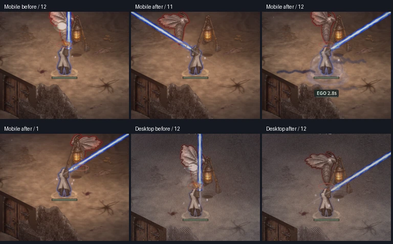

# SW-0016 회상 광선포 화면 검수

기준 커밋 `42cc2f2e`. 스토리 dist01의 같은 지점에서 게임 카메라로 촬영했다. 777 검증 환경에서 기억사수와 표적 위치를 고정했다. 데스크톱 1280×720, 모바일 가로 812×375의 Chromium 헤드리스 결과이므로 임시 검수다. 독립 검수와 iPhone Safari 실기기 확인은 대기 중이다.

## 7분야 검수

| 분야 | 점수 | 화면 관찰 |
| --- | ---: | --- |
| 미술 | 8.5 | 기존 기억사수 그림과 코발트 광선이 이어지고, 뒤쪽 후드와 총열을 구별할 수 있다. |
| 연출 | 8.5 | 같은 위쪽 자세에서 왼쪽과 오른쪽 시전 의도가 읽힌다. |
| 카메라·구도 | 8.0 | 두 뷰포트의 전투 카메라에서 시작점과 진행 방향이 한눈에 들어온다. |
| 공간·환경 | 8.0 | 양쪽 방향을 같은 골목에서 비교했다. 광선은 지형 충돌 지점에서 끝난다. |
| 조명·색채 | 8.5 | 어두운 바닥과 따뜻한 등불 위에서 가는 코발트 선과 밝은 중심을 구별할 수 있다. |
| 애니메이션·VFX | 9.0 | 기존 여섯 장 자세를 사용한다. 광선이 총구로부터 이어지며 반전된 자세에서 방향도 함께 바뀐다. |
| UX·레벨 | 8.5 | 연속 타격 범위를 가는 선 하나로 읽을 수 있다. 12시의 좌우 선택은 오른쪽으로 고정했다. |

평균 8.43/10. 기존 광선의 색 신호를 사용하고 배경 명도와 골목의 따뜻한 조명을 유지했다. 차가운 광선과 배경의 명도 대비로 한 줄의 위험 범위를 읽게 했다.

[렌더링 및 피해 기록](render-evidence.json)

11시 입력은 위쪽 그림을 반전해 화면 각도 −147.995°, 12시와 1시 입력은 원본 위쪽 그림으로 −32.005°를 그렸다. 모바일 검증에서는 표적이 광선에 들어오고 나갈 때 회상광선 피해가 0.250초, 0.733초, 0.850초에 기록됐다. 시전 중 재사용 대기를 강제로 초기화하고 한 번 더 눌러도 두 번째 광선은 생성되지 않았다.
