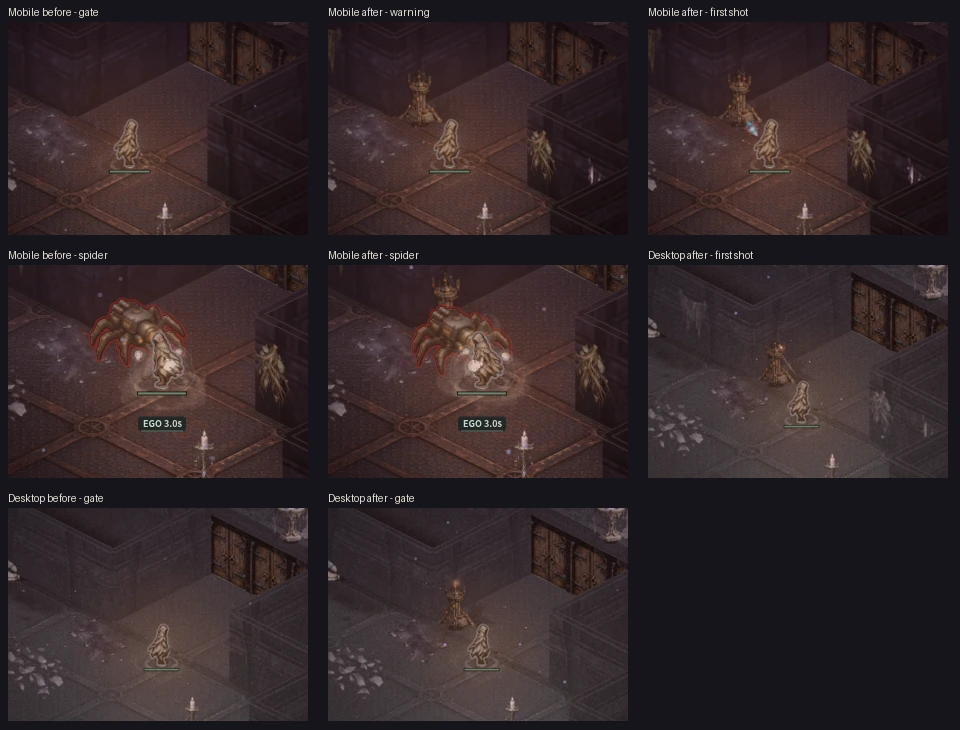

# SW-0017 시스템의 거부권 경비 터렛과 관측거미

스토리 `u204`의 보스 구역 문 바깥, 통로 한쪽에 배치했다. 영웅이 사거리 안에서 시야에 들어오면 조준 예고 뒤 세 발을 쏜다. 문과 벽은 사격을 차단한다. 보스 문을 열면 경비가 정지한다.

기존 철제 타워와 기계 드론의 대기·발사 그림을 사용했다. 두 드론 원본에서 오른쪽 포신을 같은 크기로 따서 회전하는 두 장짜리 시트로 만들었다. 관측거미는 기존 R380 옆 시트와 R1018 앞·뒤 시트의 프레임별 발끝 행을 재사용한다. [자산 출처와 해시](../../runtime-text/assets/sw0017/index.json)

## 7분야 예비 검수

| 분야 | 점수 | 화면 관찰 |
| --- | ---: | --- |
| 미술 | 8.5 | 철제 조형물과 드론 그림의 닳은 금속 재질이 골목 장식과 어울린다. |
| 연출 | 8.5 | 문 앞 경비가 접근에 반응하고 조준 예고, 세 발, 휴식 순서로 읽힌다. |
| 카메라·구도 | 8.0 | 문, 터렛, 영웅이 한 화면에 들어오고 통로 중앙에 여백이 있다. |
| 공간·환경 | 8.5 | 터렛의 밑판이 바닥에 서 있고 고정 위치가 문 개폐 동선을 피한다. |
| 조명·색채 | 8.0 | 어두운 바닥과 옅은 등불 속에서 붉은 사격 신호가 좁은 면적에 집중된다. |
| 애니메이션·VFX | 8.5 | 거미의 세 방향 발끝이 같은 바닥 기준을 유지한다. 터렛은 조준 방향을 잡고 발사 자세를 보여 준다. |
| UX·레벨 | 8.5 | 좁은 가로 화면에서도 문 옆 경비가 보인다. 시야를 끊거나 통로를 지나갈 여지가 남는다. |

평균 8.36/10. 차가운 철제 배경 위에 낡은 청동과 국소적인 적색 발사 신호를 사용했다. 골목 중간톤을 유지해 포신과 작은 발사 신호의 대비를 확보했다.

동일 위치에서 Chromium 데스크톱과 터치 가로 화면을 촬영했다. 7분야 점수는 헤드리스 예비 검수다. [렌더링·피해 측정 기록](render-evidence.json)

모바일 가로 화면의 열린 바닥에서 옆 보행 25프레임을 비교했다. 발끝과 바닥 기준의 차이는 수정 전 9.63~10.62px, 수정 후 0px였다. 앞·뒤 보행의 프레임 발끝도 데스크톱과 모바일에서 같은 기준에 맞았다. 두 화면에서 거리를 좁히면 세 발이 나가고 영웅 체력이 줄었다. 닫힌 문 뒤와 문을 연 뒤에는 탄환 수가 늘지 않았다.
